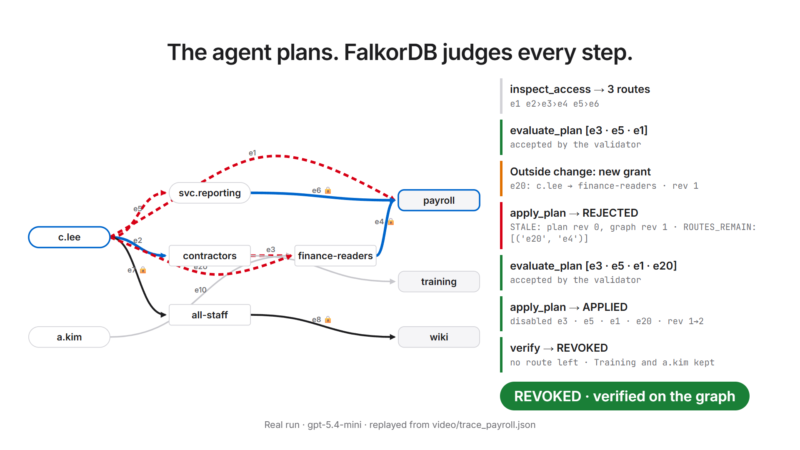

<h1 align="center">AccessCut</h1>
<p align="center">Remove someone's access. Every route. Nothing else.</p>

[](https://youtu.be/pAnXCK4__AM)

<p align="center"><b><a href="https://youtu.be/pAnXCK4__AM">▶ Watch the demo film (5 min)</a></b></p>

<p align="center"><sub>Graph Hacks · Agents That Act on Connected Data · Built on FalkorDB</sub></p>

## Deleting the direct grant isn't enough.

Access hides in group memberships, nested groups and accounts people can assume. AccessCut finds
every route to a resource and closes them all, while keeping the access that must stay.

## The agent plans. FalkorDB judges.

1. **Inspect.** FalkorDB finds every route to the resource.
2. **Propose.** The model picks edges to cut.
3. **Check.** FalkorDB rejects any plan that leaves a route open, touches a protected edge, breaks
   access that must stay, or comes from an outdated graph.
4. **Verify.** The result is read from the graph, never from the model.

## When no safe cut exists, it says so.

It refuses with the blocking route as evidence, and changes nothing.

## Tested against an independent oracle.

**24/24** tuned scenarios · **15/15** held-out scenarios ·
[How it was measured](docs/EVALUATION.md)

## Run it.

```bash
docker run -d --name falkordb -p 6379:6379 -p 3000:3000 falkordb/falkordb:latest
pip install -r requirements.txt
python check.py          # deterministic checks, no model needed
python server.py         # demo on http://localhost:8000
```

The agent needs `OPENAI_API_KEY` set in your environment. Any OpenAI-compatible endpoint works;
see the top of `agent.py`.

---

## Reference

### Graph model

| Node | Meaning |
|---|---|
| `Identity {id}` | A person or a service account |
| `Group {id}` | A group; groups can be nested |
| `Resource {id}` | Something to access, such as Payroll |
| `Meta {rev}` | Graph revision; every change increments it |
| `Op {key, identity, resource, cut, from_rev, to_rev, result}` | Audit record of an applied plan |

| Edge | From → to | Meaning |
|---|---|---|
| `MEMBER_OF` | Identity or Group → Group | Group grants flow to members |
| `CAN_ASSUME` | Identity → Identity | Inherits the other identity's access |
| `GRANTS_ACCESS` | Identity or Group → Resource | Direct permission |

Every edge has `id`, `enabled`, `removable` and `protected`. The agent may only disable edges that
are `removable` and not `protected`. Fixtures are validated before loading: labels, allowed edge
types, no cycles, and a maximum depth of 8. Unsupported input is rejected, never truncated. All
data is synthetic, in `fixture*.json`.

### Core queries

Every route from an identity to a resource, optionally simulating disabled edges (`$cut`). This
one traversal drives inspect, evaluate and verify:

```cypher
MATCH p=(u:Identity {id:$u})-[:MEMBER_OF|CAN_ASSUME|GRANTS_ACCESS*1..8]->(r:Resource {id:$r})
WHERE all(e IN relationships(p) WHERE e.enabled AND NOT e.id IN $cut)
RETURN [e IN relationships(p) | e.id]
```

Applying a plan is one atomic, revision-checked query. If the graph changed since the plan was
checked, nothing matches and the plan is rejected as `STALE`:

```cypher
MATCH (m:Meta {rev:$rev}) SET m.rev = m.rev + 1
WITH m MATCH ()-[e]->() WHERE e.id IN $cut SET e.enabled = false
WITH DISTINCT m CREATE (:Op {key:$k, identity:$u, resource:$r, cut:$cut,
                             from_rev:$rev, to_rev:m.rev, result:$res})
RETURN m.rev
```

### Agent

The model (default `gpt-5.4-mini`) acts only through four tools: `inspect_access`,
`evaluate_plan`, `apply_plan` and `verify`. It cannot write Cypher or invent grants. A
deterministic validator decides whether each plan is acceptable. Reusing an operation key is
harmless.

### Commands

```bash
python agent.py payroll --inject        # one run in the terminal, with an outside change mid-run
python eval.py 3                        # scored runs (costs API credit)
python eval.py 3 fixture_heldout.json   # held-out fixture
```

FalkorDB's browser on http://localhost:3000 shows the raw graphs.

### Limitations

No deny rules, conditional grants, expiry or real identity provider; "revoked" means revoked in
this modeled graph. The demo server runs one agent at a time. Grants added during a run are not
re-validated for cycles or depth. The cut found is valid, not necessarily the smallest.

### AI disclosure

An AI coding assistant was used to generate and debug code and to draft documentation. At
runtime, an LLM (OpenAI `gpt-5.4-mini` by default) is the agent's planning component. Every result
reported here came from running the code in this repository.

### Files

`accesscut.py` graph model and tools · `agent.py` tool-calling loop · `oracle.py` independent route
search · `check.py` deterministic checks · `eval.py` scored runs · `server.py`, `static/` demo UI ·
`results/` raw eval records ·
`docs/EVALUATION.md` full eval history
